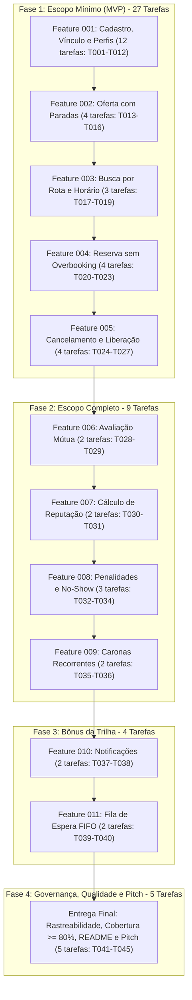

# Roadmap de Implementação Consolidado: Carona Univille

Este documento consolida o **plano mestre e checklist executivo de todas as tarefas do sistema Carona Univille** (Trilha 2 de *Spec-Driven Development*), agrupadas por **propósito verificável** de modo que cada tarefa e seus respectivos testes caibam em **um único commit de implementação**.

O planejamento foi consolidado de **125 tarefas preliminares para 45 tarefas atômicas**, mantendo a rastreabilidade integral aos requisitos do briefing (`REQ-001` a `REQ-020`) e aos princípios da [Constitution v1.1.0](file:///.specify/memory/constitution.md).

---

## 1. Visão Geral das Fases e Contagem de Tarefas

### Síntese da Consolidação
- **Contagem Original**: 125 tarefas (decomposição atômica fragmentada).
- **Nova Contagem Consolidada**: **45 tarefas** (redução de 64%, agrupando implementação + testes no mesmo commit).
- **Feature 001 (Cadastro, Vínculo e Perfis)**: **12 tarefas** (detalhadas em [specs/001-cadastro-validacao-perfis/tasks.md](file:///specs/001-cadastro-validacao-perfis/tasks.md)).

---

## 2. Checklist Consolidado das Tarefas do Sistema

---

### Fase 1: Escopo Mínimo (MVP — REQ-001 a REQ-007)

#### Feature 001: Cadastro Acadêmico, Validação de Vínculo e Perfis (`REQ-001`, `REQ-002`, `REQ-003`)
*Artefato Oficial*: [specs/001-cadastro-validacao-perfis/tasks.md](file:///specs/001-cadastro-validacao-perfis/tasks.md) | *Status*: **Pronta para Execução**

- [x] **T001**: Inicializar projeto Django `carona_univille/`, dependências em `requirements.txt`, configuração do pytest em `pytest.ini` e variáveis de ambiente PostgreSQL em `.env.example` e `carona_univille/settings.py`.
  - *Requisitos*: REQ-014, REQ-018 | *Dependências*: Nenhuma | *Como verificar*: `python manage.py check` valida a integridade da configuração do Django e `pytest --collect-only` executa sem erros de configuração ou coleta (aceitando o código de saída 5 unicamente quando indicar ausência de testes coletados).
  - *Fusão*: Agrupa antigas T001, T002, T003 e T004.
- [ ] **T002**: Implementar modelo `AcademicUser` em `accounts/models.py` (herdando de `AbstractUser` com `USERNAME_FIELD = 'email'`), migração inicial em `accounts/migrations/0001_initial.py` e testes de restrições em `tests/test_models.py` (e-mail único `@univille.br`, papel imutável, status e nome com 2 termos).
  - *Requisitos*: REQ-001, REQ-002, REQ-003 | *Dependências*: T001 | *Como verificar*: `pytest tests/test_models.py` valida as restrições do modelo no PostgreSQL.
  - *Fusão*: Agrupa antigas T005, T007 e T011.
- [ ] **T003**: Criar modelo de auditoria `AcademicValidationRecord` em `accounts/models.py`, fixture `accounts/fixtures/academic_whitelist.json`, layout base `accounts/templates/accounts/base.html` e fixtures de teste em `tests/conftest.py`.
  - *Requisitos*: REQ-001, REQ-002 | *Dependências*: T001, T002 | *Como verificar*: `python manage.py loaddata accounts/fixtures/academic_whitelist.json` carrega dados mockados.
  - *Fusão*: Agrupa antigas T006, T008, T009 e T010.
- [ ] **T004**: Implementar formulário `AcademicRegistrationForm` em `accounts/forms.py` com validação de domínio `@univille.br` e nome com 2 termos, template `accounts/templates/accounts/register.html` e testes de formulário em `tests/test_registration.py` *(Pendente de decisão da dupla: campos password e password_confirm)*.
  - *Requisitos*: REQ-001, REQ-002 | *Dependências*: T002 | *Como verificar*: Testes unitários do formulário aprovam dados válidos e rejeitam domínios externos.
  - *Fusão*: Agrupa antigas T014, T016 e parte de T012.
- [ ] **T005**: Implementar view `RegisterView` em `accounts/views.py`, rotas em `accounts/urls.py` e testes de aceitação em `tests/test_registration.py` para cadastro com papéis `PASSAGEIRO` e `MOTORISTA` nascendo como `PENDENTE` *(Pendente de decisão da dupla: auto-login para ativação vs redirecionamento para login)*.
  - *Requisitos*: REQ-001, REQ-002 | *Dependências*: T004 | *Como verificar*: `pytest tests/test_registration.py -k "test_signup"` valida Cenários 1.1, 1.2 e 1.3.
  - *Fusão*: Agrupa antigas T012, T015 e T017.
- [ ] **T006**: Implementar tratamento de cadastro duplicado com resposta neutra/genérica na `RegisterView` em `accounts/views.py` e testes em `tests/test_registration.py` comprovando unicidade e preservação de dados originais.
  - *Requisitos*: REQ-001, REQ-003 | *Dependências*: T005 | *Como verificar*: `pytest tests/test_registration.py -k "test_duplicate"` valida Cenário 4.1.
  - *Fusão*: Agrupa antiga T013 e regras de proteção de enumeração da T015.
- [ ] **T007**: Implementar serviço `AcademicValidationService` em `accounts/services.py` consultando `academic_whitelist.json` e testes unitários em `tests/test_activation.py` (contas elegíveis vs inelegíveis).
  - *Requisitos*: REQ-002 | *Dependências*: T003 | *Como verificar*: Teste unitário comprova aprovação de `joao.silva@univille.br` e recusa de `visitante.externo@univille.br`.
  - *Fusão*: Agrupa antigas T018 e T020.
- [ ] **T008**: Implementar view `ActivationView` em `accounts/views.py`, template `accounts/templates/accounts/activation.html`, rota `/accounts/activation/` e testes de integração em `tests/test_activation.py` para ativação com transição para `ATIVA` ou recusa *(Pendente de decisão da dupla: botão único vs campos adicionais)*.
  - *Requisitos*: REQ-002 | *Dependências*: T007 | *Como verificar*: `pytest tests/test_activation.py` cobre Cenários 2.1 e 2.2.
  - *Fusão*: Agrupa antigas T019, T021, T022 e T023.
- [ ] **T009**: Implementar middleware `AcademicStatusMiddleware` em `accounts/middleware.py`, registrá-lo em `settings.py` e escrever testes de integração em `tests/test_access_control.py` para isolamento de contas pendentes e bloqueio de visitantes.
  - *Requisitos*: REQ-002, REQ-003 | *Dependências*: T002, T008 | *Como verificar*: `pytest tests/test_access_control.py` cobre Cenários 3.1 e 3.3.
  - *Fusão*: Agrupa antigas T024, T026 e T027.
- [ ] **T010**: Implementar views `LoginView` e `ProfileView` em `accounts/views.py`, templates `login.html` e `profile.html` e testes de privacidade em `tests/test_privacy_lgpd.py` validando exibição de `user.display_name` ("Lucas A.") e sigilo estrito do e-mail.
  - *Requisitos*: REQ-001, REQ-003 | *Dependências*: T009 | *Como verificar*: `pytest tests/test_privacy_lgpd.py` cobre Cenários 3.2 e 4.2.
  - *Fusão*: Agrupa antigas T025, T028 e T029.
- [ ] **T011**: Criar view placeholder `/caronas/` em `carona_univille/views.py` e testes de integração em `tests/test_access_control.py` comprovando interceptação de rotas protegidas para pendentes e liberação para contas ativas.
  - *Requisitos*: REQ-002 | *Dependências*: T009 | *Como verificar*: Requisição a `/caronas/` redireciona conta pendente para ativação e libera conta ativa.
  - *Fusão*: Agrupa antiga T030 e asserções complementares de T024.
- [ ] **T012**: **[PREPARAÇÃO DA MEDIÇÃO E FECHAMENTO DA FEATURE 001]**: Criar script PowerShell `scripts/check-quality-metrics.ps1`, executar a suíte de testes de `accounts/` gerando relatório inicial `coverage.json` comprovando cobertura $\ge 80\%$ da Feature 001, registrar contagem e cobertura iniciais no topo do `README.md` e validar o roteiro do `quickstart.md`.
  - *Requisitos*: REQ-018, REQ-019 | *Dependências*: T001 a T011 | *Como verificar*: Execução do script `scripts/check-quality-metrics.ps1` exibe contagem de testes e cobertura $\ge 80\%$ de `accounts/`; `README.md` exibe indicadores iniciais.
  - *Fusão*: Agrupa antigas T031, T032, T033 e T034.

---

#### Feature 002: Oferta de Caronas e Gestão de Itinerário com Paradas (`REQ-004`)
*Status*: **Planejada no Roadmap** | *Bloqueios a fechar antes do tasks.md*: Formato do itinerário (bairros/marcos conhecidos de Joinville vs coordenadas) e momento de cadastro do veículo.

- [ ] **T013**: Implementar modelos `RideOffer` e `Waypoint` em `rides/models.py` com restrição de papel `MOTORISTA` ativo, migrações e testes unitários de ordenação sequencial de paradas em `tests/test_rides_offer.py`.
  - *Requisitos*: REQ-004 | *Dependências*: T002 | *Como verificar*: Testes unitários validam persistência da sequência de waypoints.
  - *Fusão*: Agrupa antigas T035, T036 e T037.
- [ ] **T014**: Implementar formulário `RideOfferForm` e view `RideCreateView` em `rides/views.py` com template `offer_create.html`, persistência transacional (`transaction.atomic()`) e testes de criação de oferta.
  - *Requisitos*: REQ-004 | *Dependências*: T013 | *Como verificar*: POST grava oferta e pontos de parada de forma atômica no PostgreSQL.
  - *Fusão*: Agrupa antigas T038, T039 e T040.
- [ ] **T015**: Implementar view `MyOffersView` em `rides/views.py`, template `my_offers.html` e rotas `/caronas/oferecer/` e `/caronas/minhas-ofertas/` em `rides/urls.py` para gestão das caronas ofertadas pelo motorista.
  - *Requisitos*: REQ-004 | *Dependências*: T014 | *Como verificar*: Motorista visualiza suas caronas criadas e vagas restantes.
  - *Fusão*: Agrupa antigas T041, T042 e T043.
- [ ] **T016**: Escrever testes de integração em `tests/test_rides_offer.py` validando o fluxo ponta a ponta de oferta de carona com paradas intermediárias.
  - *Requisitos*: REQ-004, REQ-017 | *Dependências*: T015 | *Como verificar*: `pytest tests/test_rides_offer.py` passa com 100% de sucesso.
  - *Fusão*: Antiga T044 preservada como suíte de aceitação da feature.

---

#### Feature 003: Busca por Rota e Janela de Horário (`REQ-005`)
*Status*: **Planejada no Roadmap** | *Bloqueios a fechar antes do tasks.md*: Tolerância padrão da janela de busca ($\pm 30$ min fixa vs customizável).

- [ ] **T017**: **[TESTE ESPECÍFICO DE ORDEM DE PARADAS E JANELA DE BUSCA]**: Implementar algoritmo determinístico `MatchingService` em `rides/services/matching_service.py` com testes unitários em `tests/test_matching.py` validando:
  - (1) **Ordem de paradas**: embarque em $P_i$ e desembarque em $P_j$ só é compatível se $i < j$ (ordem crescente).
  - (2) **Limites da janela**: tolerância de $\pm 30$ minutos em relação ao horário de partida/passagem nos limites exatos de borda.
  - *Requisitos*: REQ-005, REQ-017 | *Dependências*: T013 | *Como verificar*: `pytest tests/test_matching.py` valida matching por rota e horário.
  - *Fusão*: Agrupa antigas T045, T046 e T047.
- [ ] **T018**: Implementar formulário de busca `RideSearchForm`, template `rides/templates/rides/search.html` e regras de minimização LGPD (nome abreviado `display_name`, nota e veículo; placa e e-mail ocultos).
  - *Requisitos*: REQ-003, REQ-005 | *Dependências*: T017 | *Como verificar*: Renderização do cartão de busca não expõe e-mail nem placa do motorista.
  - *Fusão*: Agrupa antigas T048, T050 e T051.
- [ ] **T019**: Implementar view `RideSearchView` em `rides/views.py` com ordenação cronológica e testes de integração em `tests/test_ride_search.py` para o fluxo de busca de caronas por passageiro ativo.
  - *Requisitos*: REQ-005, REQ-017 | *Dependências*: T018 | *Como verificar*: `pytest tests/test_ride_search.py` valida resultados filtrados por rota e horário.
  - *Fusão*: Agrupa antigas T049, T052, T053 e T054.

---

#### Feature 004: Reserva de Vagas com Concorrência e Zero Overbooking (`REQ-006`)
*Status*: **Planejada no Roadmap** | *Bloqueios a fechar antes do tasks.md*: Confirmação de reserva instantânea automática (proposta adotada) vs aceite prévio do motorista.

- [ ] **T020**: Implementar modelo `RideBooking` em `rides/models.py` com status `CONFIRMADA`/`CANCELADA`, validação impedindo auto-reserva e migrações no PostgreSQL.
  - *Requisitos*: REQ-006 | *Dependências*: T002, T013 | *Como verificar*: Teste unitário barra motorista tentando reservar vaga na própria carona.
  - *Fusão*: Agrupa antigas T055 e T056.
- [ ] **T021**: **[TESTE ESPECÍFICO DE CONCORRÊNCIA NO POSTGRESQL]**: Implementar `BookingService.create_booking()` em `rides/services/booking_service.py` com `transaction.atomic()` e `select_for_update()`, e teste de concorrência em `tests/test_concurrency_booking.py` simulando dois passageiros disputando simultaneamente a última vaga.
  - *Asserção*: Exatamente 1 reserva confirmada, 1 rejeitada com vaga esgotada, total de vagas restantes $= 0$ (Zero Overbooking comprovado).
  - *Requisitos*: REQ-006, REQ-017, Princípio II | *Dependências*: T020 | *Como verificar*: `pytest tests/test_concurrency_booking.py` passa sem race conditions no PostgreSQL.
  - *Fusão*: Agrupa antigas T057, T058 e T059.
- [ ] **T022**: Implementar view `BookRideView` em `rides/views.py`, template `rides/templates/rides/my_bookings.html` e liberação de dados de contato (WhatsApp) e placa do carro exclusivamente entre motorista e passageiro confirmados (LGPD).
  - *Requisitos*: REQ-003, REQ-006 | *Dependências*: T021 | *Como verificar*: Visualização de contato liberada apenas após reserva confirmada.
  - *Fusão*: Agrupa antigas T060, T061 e T062.
- [ ] **T023**: Mapear rotas de reserva em `rides/urls.py` e escrever testes de integração em `tests/test_booking_flow.py` cobrindo o fluxo completo de reserva de carona.
  - *Requisitos*: REQ-006, REQ-017 | *Dependências*: T022 | *Como verificar*: `pytest tests/test_booking_flow.py` executa com sucesso total.
  - *Fusão*: Agrupa antigas T063 e T064.

---

#### Feature 005: Cancelamento de Reserva e Oferta com Prazo Mínimo (`REQ-007`)
*Status*: **Planejada no Roadmap** | *Bloqueios a fechar antes do tasks.md*: Confirmação dos prazos de 2h (passageiro) e 4h (motorista) com critério de borda inclusivo.

- [ ] **T024**: **[TESTE ESPECÍFICO DE INSTANTES DE CANCELAMENTO (BORDA)]**: Implementar serviço `CancellationService` em `rides/services/cancellation_service.py` e testes unitários em `tests/test_cancellation_deadlines.py` validando os 3 instantes de cancelamento:
  - (1) *Antes do prazo* ($\Delta t = 120\text{min } 01\text{s}$): tempestivo, livre de penalidade e vaga devolvida.
  - (2) *No limite exato de borda* ($\Delta t = 120\text{min } 00\text{s}$): tempestivo ($\Delta t \ge 120\text{min}$).
  - (3) *Depois do prazo* ($\Delta t = 119\text{min } 59\text{s}$): tardio, com registro de penalidade computada.
  - *Requisitos*: REQ-007, REQ-017 | *Dependências*: T020 | *Como verificar*: `pytest tests/test_cancellation_deadlines.py` valida os 3 instantes com precisão de segundos.
  - *Fusão*: Agrupa antigas T065 e T066.
- [ ] **T025**: Implementar devolução atômica de vaga na oferta (`vagas_disponiveis += 1`) no cancelamento do passageiro e cancelamento de oferta pelo motorista (prazo 4h) cancelando reservas atreladas.
  - *Requisitos*: REQ-006, REQ-007 | *Dependências*: T024 | *Como verificar*: Cancelamento tempestivo incrementa vagas disponíveis na busca imediatamente.
  - *Fusão*: Agrupa antigas T067 e T068.
- [ ] **T026**: Implementar views `CancelBookingView` e `CancelOfferView` em `rides/views.py`, modais de confirmação nos templates, rotas e testes integrados de cancelamento em `tests/test_cancellation_flow.py`.
  - *Requisitos*: REQ-007, REQ-017 | *Dependências*: T025 | *Como verificar*: `pytest tests/test_cancellation_flow.py` valida o ciclo de cancelamento.
  - *Fusão*: Agrupa antigas T069, T070, T071, T072 e T073.
- [ ] **T027**: **[AUDITORIA DO MVP]**: Executar toda a suíte de testes do MVP (`tests/`), gerar relatório de cobertura consolidado e validar cumprimento integral de `REQ-001` a `REQ-007` com cobertura $\ge 80\%$.
  - *Requisitos*: REQ-014 a REQ-019 | *Dependências*: T001 a T026 | *Como verificar*: Relatório de cobertura do MVP versionado com sucesso.
  - *Fusão*: Antiga T074 preservada como marco formal de encerramento do MVP.

---

### Fase 2: Escopo Completo (Extensão — REQ-008 a REQ-011)

#### Feature 006: Avaliação Mútua Pós-Viagem (`REQ-008`)
*Status*: **Planejada no Roadmap** | *Bloqueios a fechar antes do tasks.md*: Janela temporal máxima permitida para avaliar após o término da carona (proposta: até 48 horas).

- [ ] **T028**: Implementar modelo `RideReview` em `reviews/models.py` com restrições de elegibilidade pós-viagem (apenas participantes confirmados, sem auto-avaliação), migrações e testes unitários em `tests/test_reviews.py`.
  - *Requisitos*: REQ-008, REQ-017 | *Dependências*: T020 | *Como verificar*: Testes unitários validam nota de 1 a 5 e rejeição antes do término da viagem.
  - *Fusão*: Agrupa antigas T075, T076 e T077.
- [ ] **T029**: Implementar formulário `RideReviewForm`, view `SubmitReviewView` em `reviews/views.py`, template `submit_review.html`, rotas e testes de integração em `tests/test_reviews.py`.
  - *Requisitos*: REQ-008, REQ-017 | *Dependências*: T028 | *Como verificar*: `pytest tests/test_reviews.py` valida registro de avaliação mútua com sucesso.
  - *Fusão*: Agrupa antigas T078, T079, T080, T081 e T082.

---

#### Feature 007: Cálculo Matemático de Reputação (`REQ-009`)
*Status*: **Planejada no Roadmap** | *Bloqueios a fechar antes do tasks.md*: Janela deslizante de caronas consideradas na média (proposta: últimas 20 caronas).

- [ ] **T030**: **[TESTE ESPECÍFICO DE CÁLCULO NUMÉRICO DE REPUTAÇÃO]**: Implementar modelo `ReputationProfile` em `reviews/models.py` e testes unitários em `tests/test_reputation_calc.py` cobrindo cenários numéricos determinísticos:
  - (1) *Novato*: pontuação base inicial `5.00★`.
  - (2) *Média Simples*: notas `5, 5, 4, 5, 4` $\rightarrow$ média $= (5+5+4+5+4)/5 = 4.60★$.
  - (3) *Impacto Crítico*: usuário com média 5.0 recebe nota 1.0 $\rightarrow$ nova média $= (5+5+5+1)/4 = 4.00★$.
  - (4) *Janela Deslizante*: na 21ª avaliação, a nota mais antiga é descartada da média ponderada.
  - *Requisitos*: REQ-009, REQ-017 | *Dependências*: T028 | *Como verificar*: `pytest tests/test_reputation_calc.py` valida as equações matemáticas com precisão decimal.
  - *Fusão*: Agrupa antigas T083 e T084.
- [ ] **T031**: Implementar serviço `ReputationService`, conectar signals `post_save` em `RideReview` para recálculo automático, exibir estrelas no perfil/busca (LGPD) e testes integrados em `tests/test_reputation_integration.py`.
  - *Requisitos*: REQ-003, REQ-009, REQ-017 | *Dependências*: T030 | *Como verificar*: Nova avaliação atualiza imediatamente a pontuação pública exibida no perfil.
  - *Fusão*: Agrupa antigas T085, T086, T087, T088, T089 e T090.

---

#### Feature 008: Penalidades por Cancelamento Tardio e No-Show (`REQ-010`)
*Status*: **Planejada no Roadmap** | *Bloqueios a fechar antes do tasks.md*: Tolerância no ponto de encontro (10 min) e duração da suspensão temporária (7 dias após 3 no-shows).

- [ ] **T032**: **[TESTE ESPECÍFICO DE DEDUÇÃO NUMÉRICA DE PENALIDADES]**: Implementar modelo `PenaltyRecord` em `reviews/models.py` e testes unitários em `tests/test_penalties.py` cobrindo:
  - (1) *Cancelamento Tardio*: dedução fixa de $-0.20$ pontos na reputação (ex.: `4.80★` $\rightarrow$ `4.60★`).
  - (2) *No-Show*: dedução fixa de $-0.50$ pontos e atribuição de nota automática 1.0.
  - (3) *Reincidência*: 3 no-shows em 30 dias geram suspensão temporária da conta por 7 dias.
  - *Requisitos*: REQ-010, REQ-017 | *Dependências*: T030 | *Como verificar*: `pytest tests/test_penalties.py` valida as deduções e bloqueios automáticos.
  - *Fusão*: Agrupa antigas T091 e T092.
- [ ] **T033**: Implementar serviço `PenaltyService` em `reviews/services/penalty_service.py`, integração com cancelamentos tardios de `CancellationService` e fluxo de registro de No-Show (após 10 min de tolerância).
  - *Requisitos*: REQ-007, REQ-010 | *Dependências*: T024, T032 | *Como verificar*: Cancelamento tardio ou registro de no-show grava penalidade e reduz nota no banco.
  - *Fusão*: Agrupa antigas T093, T094 e T095.
- [ ] **T034**: Implementar verificação de suspensão no `AcademicStatusMiddleware`, tela de extrato de conduta `accounts/templates/accounts/penalties_history.html` e testes integrados em `tests/test_penalties_flow.py`.
  - *Requisitos*: REQ-010, REQ-017 | *Dependências*: T009, T033 | *Como verificar*: `pytest tests/test_penalties_flow.py` comprova bloqueio a usuários suspensos.
  - *Fusão*: Agrupa antigas T096, T097 e T098.

---

#### Feature 009: Caronas Recorrentes (`REQ-011`)
*Status*: **Planejada no Roadmap** | *Bloqueios a fechar antes do tasks.md*: Horizonte temporal máximo de agendamento automático de viagens (proposta: 14 dias úteis).

- [ ] **T035**: Implementar modelo `RecurringRideRule` em `rides/models.py`, serviço gerador de instâncias independentes para 14 dias úteis (`RecurringRideService`) com autonomia de cancelamento e testes unitários em `tests/test_recurring_rides.py`.
  - *Requisitos*: REQ-011, REQ-017 | *Dependências*: T013 | *Como verificar*: Teste unitário cancela uma data da série e comprova integridade das demais.
  - *Fusão*: Agrupa antigas T099, T100, T101 e T102.
- [ ] **T036**: Implementar formulário `RecurringRideForm`, comando CLI `generate_recurring_rides`, template `recurring_offers.html` e testes de integração em `tests/test_recurring_flow.py`.
  - *Requisitos*: REQ-011, REQ-017 | *Dependências*: T035 | *Como verificar*: `pytest tests/test_recurring_flow.py` valida agendamento e busca de caronas da série.
  - *Fusão*: Agrupa antigas T103, T104, T105 e T106.

---

### Fase 3: Bônus da Trilha (Diferenciais — REQ-012 e REQ-013)

#### Feature 010: Sistema de Notificações Operacionais (`REQ-012`)
*Status*: **Planejada no Roadmap** | *Bloqueios a fechar antes do tasks.md*: Formato das notificações na PoC (painel web in-app vs e-mail simulado).

- [ ] **T037**: Implementar modelo `Notification` em `notifications/models.py`, serviço `NotificationService` integrado aos gatilhos de reserva e cancelamento e testes unitários em `tests/test_notifications.py`.
  - *Requisitos*: REQ-012, REQ-017 | *Dependências*: T002, T021, T025 | *Como verificar*: Eventos de reserva e cancelamento geram notificações para os usuários envolvidos.
  - *Fusão*: Agrupa antigas T107, T108 e T109.
- [ ] **T038**: Implementar componente de sino na barra de navegação com contador de não lidas, template `notifications/list.html` e testes integrados em `tests/test_notifications.py`.
  - *Requisitos*: REQ-012, REQ-017 | *Dependências*: T037 | *Como verificar*: Usuário visualiza notificações e marca como lidas na interface.
  - *Fusão*: Agrupa antigas T110, T111 e T112.

---

#### Feature 011: Fila de Espera Automática com Repasse FIFO (`REQ-013`)
*Status*: **Planejada no Roadmap** | *Bloqueios a fechar antes do tasks.md*: Tempo limite para confirmação da vaga repassada (proposta: repasse automático imediato).

- [ ] **T039**: **[TESTE ESPECÍFICO DE REPASSE FIFO AUTOMÁTICO]**: Implementar modelo `WaitlistEntry` em `rides/models.py`, view de ingresso na fila e testes em `tests/test_waitlist.py` validando repasse estritamente FIFO para o 1º da fila quando uma vaga é liberada.
  - *Requisitos*: REQ-013, REQ-017 | *Dependências*: T020 | *Como verificar*: `pytest tests/test_waitlist.py -k "test_fifo"` comprova repasse sem intervenção manual.
  - *Fusão*: Agrupa antigas T113, T114 e T115.
- [ ] **T040**: Integrar repasse automático no `CancellationService`, exibir posição na fila no painel do passageiro e escrever testes de integração em `tests/test_waitlist_flow.py`.
  - *Requisitos*: REQ-007, REQ-013, REQ-017 | *Dependências*: T024, T039 | *Como verificar*: Cancelamento em carona com lista transfere a vaga e notifica o próximo passageiro.
  - *Fusão*: Agrupa antigas T116, T117 e T118.

---

### Fase 4: Exigências Gerais de Entrega, Qualidade e Pitch (`REQ-014` a `REQ-020`)

*Status*: **Planejada no Roadmap** | *Objetivo*: Auditoria, métricas finais, conformidade da entrega e apresentação.

- [ ] **T041**: **[RASTREABILIDADE RIGOROSA]**: Auditar e garantir que 100% dos commits de implementação sigam o padrão `feat(Txxx): ...` apontando para sua respectiva task e requisito formal.
  - *Requisitos*: REQ-014, REQ-015 | *Dependências*: Todas as tarefas de código | *Como verificar*: `git log --oneline` inspecionado comprovando rastreabilidade total.
  - *Fusão*: Antiga T119 preservada como marco de auditoria de commits.
- [ ] **T042**: **[AUDITORIA DE PROMPTS]**: Consolidar o arquivo `docs/prompts.md` com o registro cronológico e integral de todos os prompts, comandos Spec Kit e decisões conjuntas da dupla.
  - *Requisitos*: REQ-016, Princípio V | *Dependências*: Todas as interações com IA | *Como verificar*: Verificação de integridade e completude de `docs/prompts.md`.
  - *Fusão*: Antiga T120 preservada como marco de auditoria de prompts.
- [ ] **T043**: **[MEDIÇÃO CONSOLIDADA NA ENTREGA FINAL — SUÍTE GERAL E COBERTURA >= 80%]**: Executar a suíte de testes completa de todo o sistema consolidado (todas as 11 features), reutilizando o script `scripts/check-quality-metrics.ps1`, versionar o relatório final `coverage.json` comprovando cobertura global $\ge 80\%$ e atualizar definitivamente a contagem total de testes e o percentual de cobertura no topo do `README.md`.
  - *Requisitos*: REQ-017, REQ-018, REQ-019, Princípio III | *Dependências*: T001 a T040 | *Como verificar*: Reutilização do script `scripts/check-quality-metrics.ps1` gera `coverage.json` global $\ge 80\%$ versionado no Git; métricas finais consolidadas no topo do `README.md`.
  - *Fusão*: Agrupa antigas T121, T122 e T123.
- [ ] **T044**: **[SLIDES DO PITCH SEM CÓDIGO]**: Elaborar a apresentação de slides para o pitch final (máximo de 10 minutos) focando no problema de mobilidade da Univille, valor acadêmico e regras de negócio, sem código-fonte nos slides.
  - *Requisitos*: REQ-020 | *Dependências*: Nenhuma | *Como verificar*: Revisão dos slides comprovando ausência de código-fonte.
  - *Fusão*: Antiga T124 preservada para entrega de slides.
- [ ] **T045**: **[ROTEIRO E ENSAIO DA LIVE DEMO]**: Estruturar e ensaiar o roteiro da demonstração ao vivo da PoC web em até 10 minutos (cadastro, validação, oferta com paradas, busca, disputa de vaga no PostgreSQL e cancelamento).
  - *Requisitos*: REQ-020 | *Dependências*: T043, T044 | *Como verificar*: Ensaio cronometrado com execução completa em menos de 10 minutos.
  - *Fusão*: Antiga T125 preservada para apresentação ao vivo.

---

## 3. Tabela Comparativa de Fusões (Rastreabilidade Antes vs Depois)

| Nova Tarefa | Título da Nova Tarefa Consolidada | Tarefas Antigas Agrupadas |
| :---: | :--- | :--- |
| **T001** | Inicialização do Django, dependências, pytest e variáveis de ambiente | `T001`, `T002`, `T003`, `T004` |
| **T002** | Modelo `AcademicUser`, migrações e testes unitários de restrições | `T005`, `T007`, `T011` |
| **T003** | Auditoria, fixture mockada, template base e fixtures do pytest | `T006`, `T008`, `T009`, `T010` |
| **T004** | Formulário de cadastro, template e testes de validação de e-mail/nome | `T014`, `T016`, parte de `T012` |
| **T005** | View de cadastro, rotas e testes de aceitação para passageiro/motorista | `T012`, `T015`, `T017` |
| **T006** | Tratamento de cadastro com e-mail duplicado neutro e testes de integridade | `T013`, lógica neutra de `T015` |
| **T007** | Serviço de validação simulada e testes unitários com a whitelist | `T018`, `T020` |
| **T008** | View de ativação, template, rotas e testes de aceitação de ativação | `T019`, `T021`, `T022`, `T023` |
| **T009** | Middleware de isolamento de pendentes e testes de controle de acesso | `T024`, `T026`, `T027` |
| **T010** | Views de login/perfil, templates e testes de privacidade LGPD | `T025`, `T028`, `T029` |
| **T011** | View placeholder de caronas e testes de interceptação e liberação | `T030`, asserções de `T024` |
| **T012** | Preparação de script de métricas, fechamento da Feature 001 ($\ge 80\%$), README inicial e quickstart | `T031`, `T032`, `T033`, `T034` |
| **T013** | Modelos `RideOffer` e `Waypoint` com restrições e testes unitários | `T035`, `T036`, `T037` |
| **T014** | Formulário e view de criação de oferta com transação atômica e template | `T038`, `T039`, `T040` |
| **T015** | Gestão de caronas ofertadas pelo motorista (view, template e rotas) | `T041`, `T042`, `T043` |
| **T016** | Testes integrados de aceitação da oferta de carona | `T044` |
| **T017** | Algoritmo de matching com testes de ordem de paradas e janela de horário | `T045`, `T046`, `T047` |
| **T018** | Formulário de busca, template e regras de minimização LGPD | `T048`, `T050`, `T051` |
| **T019** | View de busca paginada, rotas e testes integrados de aceitação da busca | `T049`, `T052`, `T053`, `T054` |
| **T020** | Modelo `RideBooking`, validações contra auto-reserva e migrações | `T055`, `T056` |
| **T021** | Reserva atômica no PostgreSQL e teste de concorrência simultânea (zero overbooking) | `T057`, `T058`, `T059` |
| **T022** | View de reserva, template e liberação de contatos/placa (LGPD) | `T060`, `T061`, `T062` |
| **T023** | Rotas e testes integrados do fluxo completo de reserva | `T063`, `T064` |
| **T024** | Serviço de cancelamento e testes dos 3 instantes de prazo (borda) | `T065`, `T066` |
| **T025** | Devolução atômica de vagas e cancelamento de oferta com notificação | `T067`, `T068` |
| **T026** | Views e modais de cancelamento, rotas e testes integrados | `T069`, `T070`, `T071`, `T072`, `T073` |
| **T027** | Auditoria e fechamento do MVP com testes e relatório de cobertura | `T074` |
| **T028** | Modelo `RideReview` com restrições temporais e testes unitários | `T075`, `T076`, `T077` |
| **T029** | Formulário, view, template, rotas e testes integrados de avaliação mútua | `T078`, `T079`, `T080`, `T081`, `T082` |
| **T030** | Modelo `ReputationProfile` e testes com exemplos numéricos determinísticos | `T083`, `T084` |
| **T031** | Serviço `ReputationService`, signals, badge público (LGPD) e testes integrados | `T085`, `T086`, `T087`, `T088`, `T089`, `T090` |
| **T032** | Modelo `PenaltyRecord` e testes com dedução numérica direta na reputação | `T091`, `T092` |
| **T033** | Serviço de penalidades, cancelamentos tardios e registro de no-show | `T093`, `T094`, `T095` |
| **T034** | Verificação de suspensão no middleware, tela de conduta e testes integrados | `T096`, `T097`, `T098` |
| **T035** | Modelo `RecurringRideRule`, serviço para 14 dias úteis e testes unitários | `T099`, `T100`, `T101`, `T102` |
| **T036** | Formulário, comando CLI `generate_recurring_rides`, template e testes integrados | `T103`, `T104`, `T105`, `T106` |
| **T037** | Modelo `Notification`, serviço integrado a gatilhos e testes unitários | `T107`, `T108`, `T109` |
| **T038** | Componente de sino na navbar, tela de avisos e testes integrados | `T110`, `T111`, `T112` |
| **T039** | Modelo `WaitlistEntry`, view de ingresso e testes de repasse FIFO automático | `T113`, `T114`, `T115` |
| **T040** | Repasse automático no cancelamento, posição na fila e testes integrados | `T116`, `T117`, `T118` |
| **T041** | Auditoria de rastreabilidade bidirecional commit $\rightarrow$ task $\rightarrow$ requisito | `T119` |
| **T042** | Auditoria de completude e integridade de `docs/prompts.md` | `T120` |
| **T043** | Medição consolidada na entrega final reutilizando script, relatório global $\ge 80\%$ e métricas finais no README | `T121`, `T122`, `T123` |
| **T044** | Elaboração dos slides executivos do pitch (10 min) sem código | `T124` |
| **T045** | Roteiro e ensaio da live demo em até 10 minutos | `T125` |

---

## 4. Decisões Pendentes e Bloqueios Mantidos

1. **Feature 001 (Cadastro)**:
   - `T004`: Inclui provisoriamente campos de senha e confirmação, aguardando definição formal da dupla sobre a inclusão de senha no cadastro inicial.
   - `T005`: Aguarda definição da dupla se o cadastro autentica imediatamente para conduzir à ativação ou redireciona para a tela de login.
   - `T008`: Implementa ativação através de botão único de ação, aguardando confirmação da dupla sobre a necessidade de campos adicionais.
   - *Nota de Desbloqueio*: A tarefa `T001` encontra-se totalmente desbloqueada para início imediato, utilizando `python manage.py check` e tratando o código 5 de `pytest --collect-only` como ausência esperada de testes na largada.
2. **Features 002 a 011**:
   - Permanecem detalhadas neste roadmap como referência arquitetural. Seus respectivos arquivos `tasks.md` oficiais serão gerados no momento da abertura de cada especificação (`/speckit-specify` $\rightarrow$ `/speckit-plan`).
3. **Pendências Constitucionais Mantidas**:
   - `TODO(VALIDACAO_ACADEMICA)`: Homologação formal com o professor orientador sobre a validação simulada com whitelist na PoC.
   - `TODO(DOMINIOS_INSTITUCIONAIS)`: Confirmação de eventuais subdomínios institucionais além de `@univille.br`.

---
*Roadmap consolidado e homologado: 45 tarefas atômicas preparadas para implementação orientada a commits.*
