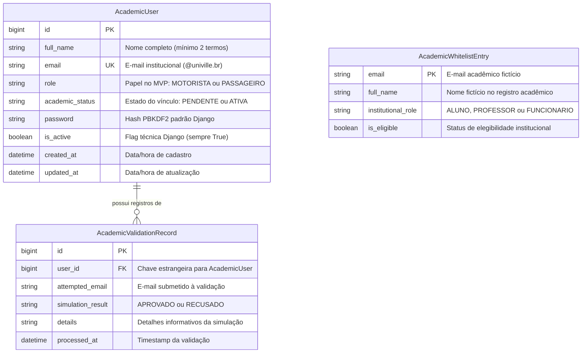
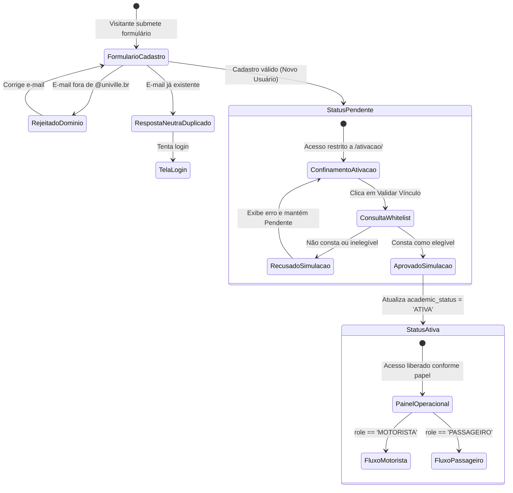

# Data Model: Cadastro Acadêmico, Validação de Vínculo e Perfis

**Feature**: `001-cadastro-validacao-perfis`  
**Data**: 2026-11-21  
**Status**: Concluído

---

## 1. Diagrama de Entidades e Relacionamentos



---

## 2. Especificação das Entidades

### 2.1. Entidade `AcademicUser`
Representa a conta do membro da comunidade acadêmica no sistema Carona Univille. Substitui o modelo `User` padrão do Django (`AUTH_USER_MODEL = 'accounts.AcademicUser'`).

| Campo | Tipo no Banco | Nulo/Vazio | Restrições & Validações | Descrição |
| :--- | :--- | :---: | :--- | :--- |
| `id` | `BIGSERIAL` | Não | Chave Primária | Identificador numérico único da conta. |
| `full_name` | `VARCHAR(150)` | Não | Mínimo de 2 palavras (prenome e sobrenome), sem caracteres especiais. | Nome completo do usuário. |
| `email` | `VARCHAR(254)` | Não | `UNIQUE`, domínio obrigatório `@univille.br`. | E-mail institucional usado para login e identificação acadêmica. |
| `role` | `VARCHAR(20)` | Não | Choices: `'MOTORISTA'`, `'PASSAGEIRO'`. Imutável no MVP. | Papel de atuação na plataforma. |
| `academic_status` | `VARCHAR(20)` | Não | Choices: `'PENDENTE'`, `'ATIVA'`. Default: `'PENDENTE'`. | Estado regulatório do vínculo acadêmico. |
| `password` | `VARCHAR(128)` | Não | Hash criptográfico do Django (PBKDF2/SHA256). | Credencial de acesso. |
| `is_active` | `BOOLEAN` | Não | Default: `True`. | Flag técnica de autenticação do Django. |
| `is_staff` | `BOOLEAN` | Não | Default: `False`. | Controle de acesso ao painel de administração. |
| `created_at` | `TIMESTAMPTZ` | Não | `auto_now_add=True`. | Data e hora de criação do registro. |
| `updated_at` | `TIMESTAMPTZ` | Não | `auto_now=True`. | Data e hora da última modificação. |

#### Propriedades de Domínio e Métodos de Suporte (LGPD)
- **`display_name` (LGPD / Princípio I)**: Retorna o primeiro nome seguido da inicial do sobrenome (ex.: `"Lucas Aluno"` $\rightarrow$ `"Lucas A."`). Utilizado em todas as listagens públicas e interfaces de busca aberta para evitar exposição desnecessária do nome completo.
- **`is_pending`**: Retorna `True` se `academic_status == 'PENDENTE'`.
- **`is_activated`**: Retorna `True` se `academic_status == 'ATIVA'`.
- **Imutabilidade do Papel**: No método `save()`, se a instância já possui PK no banco de dados, o sistema impede a modificação do campo `role`, garantindo a aderência à decisão da dupla (Opção A — papel fixo no MVP).

---

### 2.2. Entidade `AcademicValidationRecord`
Armazena a auditoria dos eventos de tentativa de validação institucional simulada.

| Campo | Tipo no Banco | Nulo/Vazio | Restrições & Validações | Descrição |
| :--- | :--- | :---: | :--- | :--- |
| `id` | `BIGSERIAL` | Não | Chave Primária | Identificador único do log de validação. |
| `user` | `BIGINT` (FK) | Não | `on_delete=models.CASCADE`, `related_name='validation_records'` | Conta acadêmica associada. |
| `attempted_email` | `VARCHAR(254)` | Não | Formato de e-mail | Endereço submetido na tentativa. |
| `simulation_result` | `VARCHAR(20)` | Não | Choices: `'APROVADO'`, `'RECUSADO'`. | Desfecho da consulta à whitelist. |
| `details` | `TEXT` | Sim | Opcional | Mensagem de diagnóstico ou motivo da recusa. |
| `processed_at` | `TIMESTAMPTZ` | Não | `auto_now_add=True`. | Timestamp do processamento. |

---

### 2.3. Catálogo de Homologação Mock (`AcademicWhitelistEntry`)
Catálogo desacoplado em memória / fixture JSON (`accounts/fixtures/academic_whitelist.json`) utilizado pelo `AcademicValidationService` na PoC.

#### Exemplo de Estrutura da Fixture
```json
[
  {
    "email": "joao.silva@univille.br",
    "full_name": "João da Silva",
    "institutional_role": "ALUNO",
    "is_eligible": true
  },
  {
    "email": "mariana.motorista@univille.br",
    "full_name": "Mariana Souza",
    "institutional_role": "PROFESSOR",
    "is_eligible": true
  },
  {
    "email": "lucas.aluno@univille.br",
    "full_name": "Lucas Aluno",
    "institutional_role": "ALUNO",
    "is_eligible": true
  },
  {
    "email": "bloqueado@univille.br",
    "full_name": "Usuário Trancado",
    "institutional_role": "ALUNO",
    "is_eligible": false
  }
]
```

*Nota*: Qualquer e-mail não listado acima (ex.: `visitante.externo@univille.br`) é automaticamente tratado como inelegível pelo simulador de testes.

---

## 3. Máquina de Estados do Ciclo de Vida da Conta



---

## 4. Regras de Integridade e Persistência no PostgreSQL

1. **Unicidade Estrita**: A coluna `email` na tabela `accounts_academicuser` possui restrição `UNIQUE` nativa no PostgreSQL, impedindo concorrência na inserção duplicada.
2. **Isolamento de Transação**: A validação e a atualização de status em `AcademicValidationService` são executadas dentro de um bloco transacional `transaction.atomic()`.
3. **Persistência de Auditoria**: Mesmo em caso de recusa na validação institucional, o registro em `AcademicValidationRecord` é persistido com `simulation_result = 'RECUSADO'`, garantindo rastreabilidade do histórico.
